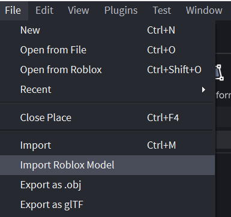
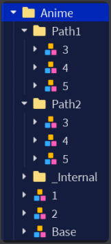
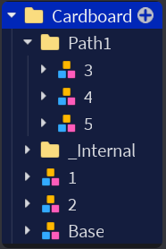

# Making a non-animated tower skin
A non-animated skin swaps the tower's parts for your own meshes but keeps the tower's normal animations. You name each of your parts after the tower part it replaces, and the game attaches it there.

- This guide isn't for skins with their own animations, or for texture skins (the default tower with a new texture or colour).
- **Don't use welds.** The game attaches every part for you. If you find yourself welding, something has gone wrong.
- You'll work in the **Skin Workshop** place with the **Skin Preview** plugin. It shows your skin on the real tower as you build it, and checks your part names.

## First-time setup
### Get the files
- From Discord:
  - [`SkinWorkshop.rbxl`](https://discord.com/channels/1307254435579170827/1474445894970507418/1567655506569592913): the place you'll work in.
  - [`SkinPreview.rbxmx`](https://discord.com/channels/1307254435579170827/1474445894970507418/1567655382921257132): the Skin Preview plugin.
- From this page: [`TDX_Plugin_Lite.rbxmx`](TDX_Plugin_Lite.rbxmx), a plugin with handy commands for formatting your skin. The download button is in the top right corner:

### Install the plugins
https://github.com/user-attachments/assets/d70b086f-04f2-4b3d-bd50-18c9b4ef0dc9
Do these steps once for `SkinPreview.rbxmx` and once for `TDX_Plugin_Lite.rbxmx`:
1. Open any place in Studio. Click **File** > **Import Roblox Model** and pick the file you downloaded:

2. In the Explorer, right-click what you just added and click **Save as Local Plugin...**:

3. Click **Save** in the window that pops up. Keep the file name it suggests.

4. Delete what you added from the Explorer. The plugin is installed, so you don't need it any more.

### Open them
- **Skin Preview:** open `SkinWorkshop.rbxl`. The **TDX Skin Preview** panel opens by itself. If you close it, click **Skin Preview** in the **PLUGINS** tab.
- **Commands Lite:** click **Commands Lite** in the **PLUGINS** tab:

  A list of commands opens at the bottom of the screen. Press Ctrl+Shift+T to hide or show it.

## Look at a finished skin first
On the plugin's start page:
- **Open an example** adds a copy of a finished skin to Workspace. It's only a copy, so feel free to take it apart.
- **Copy the *tower* rig** adds the tower's own models to Workspace, one for each level, so you can see what every part is called.

## How a skin is set up
Your skin is a Folder named after the skin. Inside it is one Model for each tower level:
- **Base**, **1** and **2** go straight into the folder.
- Levels **3**, **4** and **5** go into a **Path1** folder, and also a **Path2** folder if the tower has two paths.

Ignore `_Internal` in these pictures. The TDX team adds it.

| A tower with two paths | A tower with one path |
| --- | --- |
|  |  |

Not sure if your tower has one path or two? Use **Copy the *tower* rig** to check.

Each level model needs:
- **A root part.** An invisible part with the same name as the tower's root (the plugin tells you the name). Set it as the model's **PrimaryPart**. The game uses it to line your model up with the tower.
- **Your parts, named exactly like the tower parts they replace,** including spaces and capital letters: `Torso`, `Left Arm`, `Head`...
- **One part for each tower part.** If a piece is made of several meshes, put the extra meshes inside one main MeshPart. Don't group them in a Model.
- **Extra meshes unanchored.** The game unanchors the main parts, but not the meshes inside them. Anchored meshes stay frozen while the tower moves.

Place everything around the root where it should sit on the tower when it's standing still. The preview shows you if it's right.

## Preview and fix your skin
1. Put your skin in Workspace and click any part of it in the Explorer.
2. Check the plugin picked the right tower (change it if not), then click **Preview skin**.

Your skin appears in the middle of the baseplate on the real tower, playing its animations. The original tower stands next to it.

**Preview tab**
- Pick a level from the level list.
- That level's model also stands behind the preview, standing still. Edit it there and the preview updates right away. It goes back to its old spot when you switch levels or click **Exit**.
- **Show all levels** lines up every level behind the preview. To copy a part to another level, paste it into that level's model, then move it sideways by the distance shown for each level in between. For example, 2 levels over at 4 studs apart is 8 studs. It ends up in the same spot on that level.
- Under **Show**, turn effects, the original tower and problem highlights on or off.

**Checks tab**
- Lists anything that will look wrong in game, like a misnamed part, a missing root part, or a missing arm or gun.
- **Show me** selects the parts with the problem. Many problems have a fix button, like **Rename to "Left Arm"**.
- If something is flagged but you meant it, click **It's on purpose**.

**Body parts tab**
- Lists every part of the tower for this level, and whether your skin replaces it.
- To name one of your parts, select it in the Explorer, then click **Name it** next to the tower part it replaces.
- **Effect points** are where effects like muzzle flashes start. If your gun's barrel isn't where the default gun's is, click **Move it**. A bright pink ball appears where the effect starts now. Drag it to the end of your barrel.

## Send it
When the Checks tab shows no errors, click **Save skin file to send** at the bottom. Save the `.rbxm` file and send it to the TDX team on Discord.

You can save with warnings, but read them first. Each one is something that will look different in game.
